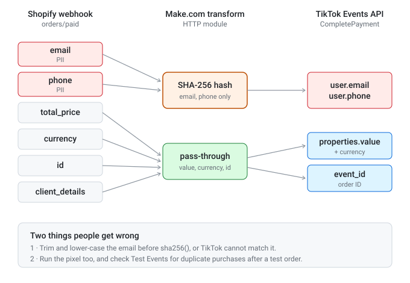

# Shopify → TikTok Events API field mapping

How the Shopify `orders/paid` webhook payload maps to TikTok Events API parameters in the HTTP module. All PII is SHA-256 hashed before sending, per TikTok's spec.

| TikTok parameter | Source (Shopify webhook) | Hashed? |
|------------------|--------------------------|---------|
| `event` | constant: `CompletePayment` | no |
| `event_time` | `created_at` (Unix) | no |
| `event_id` | `id` (the order ID) | no |
| `user.email` | `email`, trimmed and lower-cased first | SHA-256 |
| `user.phone` | `phone`, spaces removed; sent empty when the order has none | SHA-256 |
| `user.ip` | `client_details.browser_ip` | no (TikTok hashes server-side) |
| `user.user_agent` | `client_details.user_agent` | no |
| `properties.value` | `total_price` | no |
| `properties.currency` | `currency` | no |
| `properties.order_id` | `id` | no |

`properties.contents` (line items) is not in the shipped blueprint. Add it with an iterator and an aggregator if you run TikTok catalogue ads.

> The HTTP module sends a raw JSON body, and Make.com evaluates the `{{...}}` expressions inside it, including `sha256(...)`. After importing, open the module and check the expressions show as mapped items, not plain text.

> **Deduplication:** TikTok can only merge a browser event and a server event that carry the same `event_id`. This blueprint uses the Shopify order ID. Shopify's TikTok app does not document the `event_id` its pixel sends, so check Test Events and Diagnostics in TikTok Events Manager for duplicate purchases after a test order.

Full explanation: https://stackarchitect.xyz/tiktok-events-api-shopify/
